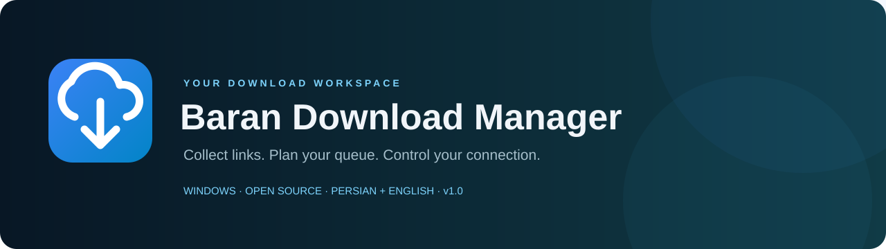

<div align="center">



[](https://github.com/mehdiporbaba/Baran-Download-Manager/releases)
[](LICENSE)
[](https://github.com/mehdiporbaba/Baran-Download-Manager/releases/latest)

**Collect links. Plan your queue. Control your connection.**

[Download](https://github.com/mehdiporbaba/Baran-Download-Manager/releases/latest) · [Browser extension](browser-extension) · [Setup guide](docs/GUIDE.md) · [فارسی](#باران-دانلود-منیجر)

</div>

**Firefox installation fixed:** use the [Mozilla-signed Firefox 1.0.1 XPI](https://github.com/mehdiporbaba/Baran-Download-Manager/releases/tag/firefox-v1.0.1), then connect Firefox in Baran Settings → Browser integration. Do not use the old unsigned development XPI. [Signing details](docs/FIREFOX-SIGNING.md).

**2.1.0-beta.1 prerelease:** Real-Debrid, authenticated private-LAN mobile control, Windows wake tasks and experimental HTTP-only IPv4 VPN binding. [Scope and limits](docs/RELEASE-2.1.0-beta.1.md). Latest stable desktop: **2.0.0**.

## A workspace built around your downloads

Baran Download Manager brings direct files, scheduled jobs, browser links, media and torrents into one desktop workspace. Version 2.0 uses a native C# backend and the shared Windows WebView2 Runtime: roughly 2.5 MB Setup / 3.2 MB Portable ZIP in local builds, with no bundled Electron, Node.js or Chromium runtime. It opens All downloads with a collapsible menu and keeps your review inbox on disk. [Architecture and measurements](docs/NATIVE.md).

This is an independently maintained GPL fork of [Pulse Download Manager](https://github.com/TheGreatAzizi/Pulse-Download-Manager), extended by **Mehdi Porbaba**. The original authors and licensing are credited below.

## What's inside

| Workspace | What you can do |
| --- | --- |
| **Link Grabber** | Paste text or import TXT, deduplicate links, check availability, filter file extensions, and download a selection. |
| **Folder scanner** | Discover linked files in an HTML directory or page tree, with depth/page limits, cancellation and an explicit preview. |
| **Scheduling** | Set a local start date/time when adding files or a batch. Scheduled jobs are saved with the download queue. |
| **Browser extension** | Mozilla-signed Firefox XPI, Chrome/Edge development sources, optional acknowledged handoff and in-app Native Messaging registration. Public store listings remain pending. |
| **Expired links** | Replace a paused/error HTTP URL after verifying size, a strong ETag and saved segment boundaries, then resume without resetting offsets. |
| **YouTube & video** | Use yt-dlp to select quality, audio, subtitles and playlist items. Optional tools are managed in Settings. |
| **Instagram** | Use gallery-dl to collect photos, video posts, reels, carousels and accessible stories into the review inbox. |
| **Torrent controls** | Configure separate download and upload/seeding rate limits and select whether seeding continues after completion. |
| **Proxy routing** | Direct, automatic system/PAC, or manual HTTP(S)/SOCKS routing for web downloads and media tools. |
| **Desktop integration** | Installed Windows startup, minimize/close to system tray, notifications, Persian RTL and light/dark themes. |

## Download & start

Open the [latest release](https://github.com/mehdiporbaba/Baran-Download-Manager/releases/latest).

- **Setup**: `Baran-Download-Manager-Native-Setup-2.0.0-x64.exe` — compact Windows installer and shortcuts.
- **Portable**: `Baran-Download-Manager-Native-Portable-2.0.0-x64.zip` — extract into a stable folder and run `Baran Download Manager.exe`.
- **Extensions**: Chrome/Edge development ZIP; use the separate [Mozilla-signed Firefox release](https://github.com/mehdiporbaba/Baran-Download-Manager/releases/tag/firefox-v1.0.1) instead of the historical unsigned XPI in desktop 2.0.0.

Windows 10/11 x64 needs .NET Framework and the shared Microsoft WebView2 Evergreen Runtime. WebView2 is already present on many PCs; a missing runtime requires a separate Microsoft download. The app is unsigned unless the release explicitly provides a verified trusted publisher signature. Self-signed certificates do not solve public SmartScreen trust. Optional `yt-dlp`, `gallery-dl` and `ffmpeg` are separate tools and can be much larger than Baran. No guarantee is made that every source-site challenge or protected account works.

## Browser integration

1. In `chrome://extensions` or `edge://extensions`, turn on **Developer mode** and choose **Load unpacked**.
2. Select the unpacked `browser-extension` directory and copy the extension ID.
3. In Baran, open **Settings → Browser integration**, select the browser, paste that development extension ID and click **Connect browser**. No PowerShell command is required.

Firefox has a fixed add-on ID and needs no copied ID in Baran. Its **signed.xpi** is approved by Mozilla for self-distribution and ordinary Firefox installation. Chrome/Edge still need store publication for ordinary-user onboarding; a plain ZIP/CRX does not bypass store requirements. In the extension popup you can opt in to handling new HTTP(S) downloads; it resumes the browser if Baran cannot acknowledge receipt. [Guide](docs/GUIDE.md) · [Privacy](browser-extension/PRIVACY.md).

## Why do some media links need a login?

Public content may work without logging in. A desktop downloader cannot automatically inherit the session from an open browser tab. Restricted stories, private posts, age checks and service-side bot checks may require cookies from your own authorized session.

The extension can collect HTTP(S) media URLs already present in a page you can access. This is different from guaranteeing access to every video player: `blob:` objects, encrypted streams, expiring URLs and POST-based downloads may need a different integration. Baran does not bypass account permissions or DRM.

## Scope & current limits

- A scanner can discover **linked files**, not hidden files that the server never lists. Traversal stays within the seed origin and containing directory. Remote subfolder recreation is not included in 1.0.
- The native app persists the link review inbox, download tasks and scheduled times. Keep Baran running; the scheduler does not yet wake a sleeping or shut-down computer.
- Web proxy settings do not tunnel torrent peer or DHT traffic. Use an operating-system VPN when all torrent traffic must be routed. Authenticated proxy URLs are not supported in 1.0.
- Instagram extraction depends on gallery-dl, Instagram availability and your access. Stories/private content may require an authorized session. CDN URLs can expire and need re-extraction.
- The extension is shipped unpacked, not published in browser stores. Native Messaging setup in 1.0 targets Windows; Linux source builds do not yet include that host.
- The native package contains no WebTorrent/Node modules. Inherited npm findings remain in the legacy source/build environment; native dependencies have their own update needs. This is not a claim of a clean vulnerability audit. See [validation notes](docs/VALIDATION.md) and the [runtime inventory](native/runtime-components.json).

## Build from source

Use Windows, **Node.js 24**, npm and the Windows .NET Framework C# compiler. The build downloads pinned and checksum-verified native SDK/engine archives.

```powershell
git clone https://github.com/mehdiporbaba/Baran-Download-Manager.git
cd Baran-Download-Manager
npm ci
npm test
npm run typecheck
npm run build:native
npm run test:native
npm start
```

```powershell
npm run build
npm run dist:win
```

The native target is Windows x64. The retained Electron implementation has explicit `dev:electron`, `start:electron`, `dist:electron:win` and `dist:electron:linux` commands for development/rollback. A retained Linux configuration is not a tested native Linux release. [Product roadmap](docs/ROADMAP.md).

## باران دانلود منیجر

**Baran Download Manager** یک فضای یکپارچه برای مدیریت دانلود است: لینک‌گیر گروهی، اسکن پوشه‌های دارای فهرست، زمان‌بندی شروع، افزونه مرورگر، دریافت رسانه و تنظیم اتصال.

- پنجره اولیه با فضای نمایشگر هماهنگ می‌شود و به‌صورت پیش‌فرض بزرگ و تمام‌صفحه نیست.
- نسخهٔ بومی ۲ از C# و WebView2 ویندوز استفاده می‌کند؛ Electron و Node همراه برنامه نصب نمی‌شوند. بستهٔ نصب اولیه حدود ۲٫۵ مگابایت است، اما WebView2 و ابزارهای رسانه پیش‌نیازهای جداگانه‌اند.
- برنامه با «همهٔ دانلودها» شروع می‌شود. منو با آیکون سه‌خط باز می‌شود و پس از ۱۵ ثانیه بیرون‌بودن نشانگر و فوکوس بسته می‌شود؛ گزینهٔ ثابت‌ماندن در تنظیمات عمومی است.
- Inbox روی دیسک می‌ماند. برای فایل‌های مستقیم ناقص، دکمهٔ تعویض لینک، تطابق لینک تازه را پیش از ادامه بررسی می‌کند.
- برای زمان‌بندی، در پنجره دانلود جدید یا لینک‌گیر، تاریخ و ساعت شروع را وارد کن؛ برنامه باید هنگام موعد باز باشد.
- در **Settings → Speed** سرعت HTTP/ویدیو و سقف‌های دانلود و آپلود تورنت را تنظیم کن. صفر یعنی نامحدود.
- در **Settings → Network & proxy** اتصال مستقیم، پراکسی سیستم/PAC یا پراکسی دستی را انتخاب کن.
- برای اینستاگرام، بخش **Instagram** را باز کن و ابزار مربوط را نصب کن. محتوای عمومی الزاماً به ورود نیاز ندارد؛ محتوای خصوصی و برخی استوری‌ها ممکن است نشست مجاز خودت را بخواهند.
- تنظیمات اجرای خودکار ویندوز و ادامه فعالیت در Tray در بخش عمومی تنظیمات قرار دارد.

## Credits & license

Copyright © 2026 **TheGreatAzizi** and the original Pulse contributors for the upstream application. Baran extensions, integration and identity © 2026 **Mehdi Porbaba**.

Distributed under **GNU GPL v3.0 or later**. See [LICENSE](LICENSE). Source for this release is available in this repository. yt-dlp, gallery-dl, ffmpeg, Electron, WebTorrent and other dependencies retain their respective licenses.
